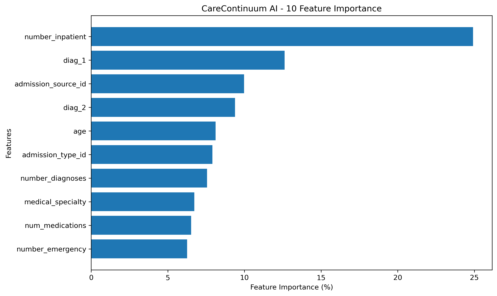

# CareContinuum AI
### Machine Learning-Based Hospital Readmission Estimation

CareContinuum AI is an educational machine-learning project that explores whether information recorded during a hospital encounter can help estimate the probability of a subsequent readmission. The project uses the **Diabetes 130-US Hospitals for Years 1999–2008** dataset and deploys a compact CatBoost classifier through Streamlit.

> **Important:** This is an academic demonstration, not a clinical decision-support system. It has not been clinically validated and must not be used to make patient-care decisions.

## Live application and source code

- **Live application:** https://carecontinuum-ai.streamlit.app/
- **GitHub repository:** https://github.com/nagayaswanth18/CareContinuum-AI

## Project objectives

1. Explore and understand a real-world hospital encounters dataset.
2. Establish baseline classification performance.
3. investigate class imbalance and compare traditional machine-learning algorithms.
4. Train and evaluate CatBoost models using patient-grouped data splitting.
5. Reduce the number of inputs while retaining similar predictive performance.
6. Build an interactive web application for an educational demonstration.

## Dataset and target definition

**Dataset:** Diabetes 130-US Hospitals for Years 1999–2008, from the UCI Machine Learning Repository.

The original dataset contains 101,766 encounters and 50 columns.

For the final binary task, the original `readmitted` field was mapped as follows:

| Original value | Binary target | Meaning in this project |
|---|---:|---|
| `NO` | 0 | No recorded readmission |
| `>30` | 1 | Readmitted after more than 30 days |
| `<30` | 1 | Readmitted within 30 days |

Thus, the final target means **any recorded readmission (`>30` or `<30`) versus no recorded readmission (`NO`)**. It is not a specific 30-day readmission prediction task.

The project excluded encounters with discharge disposition IDs `[11, 13, 14, 19, 20]`, removed `weight`, `citoglipton`, and `examide`, converted `?` values to missing values, and represented missing categorical values as `Unknown`.

The cleaned modelling dataset contained **99,343 encounters and 48 columns**. For modelling, identifier and target-leakage columns were excluded from the feature matrix. `patient_nbr` was retained separately only to support patient-grouped splitting.

## Modelling workflow

### 1. Initial three-class exploration

The first notebook explored the original three readmission categories (`NO`, `>30`, `<30`). It established a majority-class baseline and compared Logistic Regression, class-weighted Logistic Regression, and an exploratory Random Forest.

Five-fold patient-grouped cross-validation was used for the Logistic Regression experiments. Accuracy and macro F1 were examined because accuracy alone can hide poor performance on minority classes.

| Experiment | Configuration / approach | Mean accuracy | Mean macro F1 |
|---|---|---:|---:|
| Dummy Classifier | Majority-class baseline | 52.84% | 0.2305 |
| Logistic Regression | `max_iter=1000`, `random_state=42` | 57.35% | 0.3914 |
| Class-weighted Logistic Regression | Same settings, `class_weight="balanced"` | 48.17% | 0.4262 |
| Random Forest | Full initial run with 200 trees; run was too slow to complete | Not available | Not available |
| Random Forest exploratory run | Smaller 10% subset / reduced configuration | 54.43% validation accuracy | 0.3591 validation macro F1 |

**Interpretation:** Class weighting reduced overall accuracy but improved macro F1, indicating a better balance across the three classes. In particular, the recall for the `<30` class increased substantially (approximately 0.02 to 0.40 in the experiment shown). The full 200-tree Random Forest run took too long, so a smaller exploratory experiment was attempted. That exploratory result is not directly comparable to the five-fold cross-validation results.

### 2. Transition to binary classification

For the final application task, `>30` and `<30` were combined into the positive class (readmitted), while `NO` became the negative class (not readmitted).

The final cleaned binary modelling data contained 99,343 encounters and 42 candidate input features after removing identifiers and target-related columns. The target distribution was approximately 52.9% not readmitted and 47.1% readmitted.

To reduce patient leakage, the project used patient-grouped train/test splitting. The held-out test partition contained 19,802 encounters; the training partition contained 79,541 encounters. No patient was shared between the partitions. A validation partition was created from the training partition for model selection.

### 3. CatBoost model development

CatBoost was selected for the final modelling stages because the dataset contains many categorical variables.

The principal training configuration used:
- `iterations=700`
- `learning_rate=0.05`
- `depth=6`
- `loss_function="Logloss"`
- `eval_metric="F1"`
- `random_seed=42`
- `early_stopping_rounds=50`
- `allow_writing_files=False`

Three feature-set stages were investigated:

| Model | Features | Validation accuracy | Validation readmitted-class F1 | Held-out test accuracy | Held-out test readmitted-class F1 |
|---|---:|---:|---:|---:|---:|
| CatBoost full | 42 | 64.09% | 0.5775 | — | — |
| CatBoost reduced | 22 | 64.20% | 0.5760 | 63.69% | 0.5846 |
| CatBoost compact, initial | 10 | 63.80% | 0.5695 | — | — |
| CatBoost compact, tuned | 10 | 63.80%* | 0.5727* | 63.46% | 0.5836 |

`*` Validation results for the best tuned 10-feature configuration.

The 22-feature model removed 20 individual medication columns while retaining `insulin`, `diabetesMed`, and `change`.

The compact model used these 10 features:

1. `number_inpatient`
2. `diag_1`
3. `admission_source_id`
4. `diag_2`
5. `number_diagnoses`
6. `medical_specialty`
7. `admission_type_id`
8. `num_medications`
9. `number_emergency`
10. `age`

Eight hyperparameter configurations were evaluated for the compact model. The selected configuration was:
- Depth: 6
- Learning rate: 0.05
- L2 regularization: 5
- Best iteration / final refit iterations: 484

The selected model was refitted on the full training partition (79,541 encounters) and evaluated once on the held-out test partition (19,802 encounters).

## Final application model performance

The deployed application uses the tuned 10-feature CatBoost model.

| Metric | Held-out test result |
|---|---:|
| Accuracy | 63.46% |
| Readmitted-class precision | 62.82% |
| Readmitted-class recall | 54.49% |
| Readmitted-class F1 | 0.5836 |

Confusion matrix (rows = actual class; columns = predicted class):

|  | Predicted not readmitted | Predicted readmitted |
|---|---:|---:|
| Actual not readmitted | 7,495 | 3,001 |
| Actual readmitted | 4,235 | 5,071 |

The 22-feature model had slightly higher held-out test accuracy (63.69%) and readmitted-class F1 (0.5846). The 10-feature model had slightly higher readmitted-class recall (54.49% versus approximately 54.37%) and requires 12 fewer user inputs. The compact model was selected for the application because it offers a simpler input experience with very similar measured performance. This small observed difference does not establish statistical superiority.

## Feature importance

The final 10-feature CatBoost model's global feature-importance scores were:

| Feature | Importance |
|---|---:|
| `number_inpatient` | 24.913 |
| `diag_1` | 12.616 |
| `admission_source_id` | 9.974 |
| `diag_2` | 9.382 |
| `age` | 8.119 |
| `admission_type_id` | 7.914 |
| `number_diagnoses` | 7.560 |
| `medical_specialty` | 6.734 |
| `num_medications` | 6.525 |
| `number_emergency` | 6.264 |

These are model-derived global importance scores. They describe how the fitted model uses features; they do not establish causation or clinical risk factors.



## Repository structure

```text
CareContinuum-AI/
├── app/
│   └── app.py
├── docs/
│   └── feature_importance_10features.png
├── models/
│   ├── carecontinuum_catboost_10features.cbm
│   ├── model_metadata_10features.json
│   ├── category_options_10features.json
│   ├── numeric_stats.json
│   └── comparison / backup model files
├── notebooks/
│   ├── 01_data_understanding.ipynb
│   └── 02_model_training.ipynb
├── CareContinuum_AI_Model_Development_Record.md
├── CareContinuum_AI_Model_Results.md
├── requirements.txt
└── .gitignore
```

The raw dataset ZIP is excluded from Git using `.gitignore`. Please obtain the dataset from the UCI repository using the citation below.

## Run locally

Python 3.11 is recommended. From the repository root:

```bash
python -m venv .venv
```

Activate the environment, then install dependencies:

```bash
pip install -r requirements.txt
```

Start the Streamlit application:

```bash
python -m streamlit run app/app.py
```

## Limitations and responsible use

- The data is historical (1999–2008) and may not represent current hospital practice or patient populations.
- The target combines readmissions within 30 days and after 30 days. It is not a dedicated 30-day readmission endpoint.
- The model is evaluated on a held-out dataset split by patient, but external and prospective validation have not been performed.
- The reported metrics indicate moderate predictive performance and should not be interpreted as clinical effectiveness.
- Predictions depend on the selected classification threshold (0.50) and the input values supplied.
- Feature importance is not causal evidence.
- The application is an educational prototype only, not medical advice or a clinical decision tool.

## References

1. Clore, J., Cios, K., DeShazo, J., & Strack, B. (2014). *Diabetes 130-US Hospitals for Years 1999–2008*. UCI Machine Learning Repository. https://doi.org/10.24432/C5230J
2. Strack, B., DeShazo, J. P., Gennings, C., Olmo, J. L., Ventura, S., Cios, K. J., & Clore, J. N. (2014). *Impact of HbA1c Measurement on Hospital Readmission Rates: Analysis of 70,000 Clinical Database Patient Records*. BioMed Research International, 2014, 781670. https://doi.org/10.1155/2014/781670
3. Prokhorenkova, L., Gusev, G., Vorobev, A., Dorogush, A. V., & Gulin, A. (2018). *CatBoost: Unbiased Boosting with Categorical Features*. NeurIPS 31. https://proceedings.neurips.cc/paper/2018/hash/14491b756b3a51daac41c24863285549-Abstract.html
